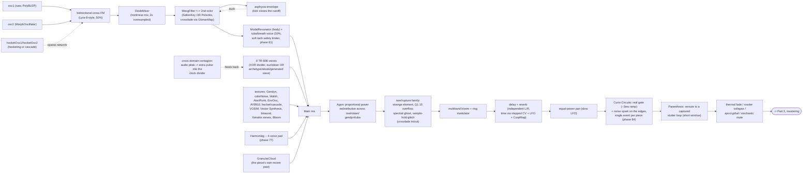
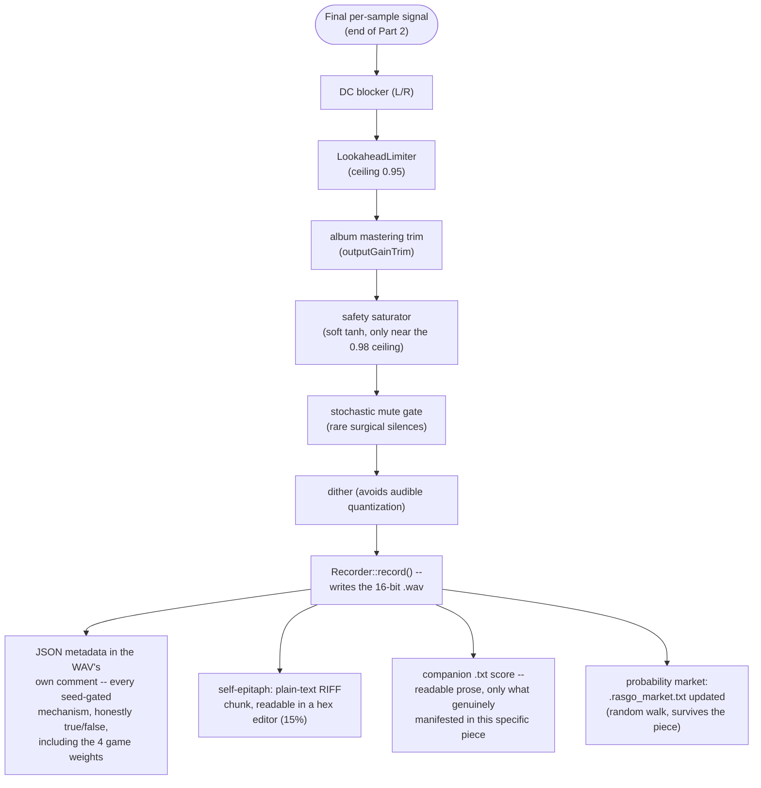

# Rasgo Synth -- architecture flowchart (phase84 baseline, operational update 2026-08-22)

Replaces the Mermaid flowchart published as an artifact in phase 38 (and the
illustrated/blueprint version redesigned afterward, both outside the
repository -- this session has no access to an artifact-publishing tool, so
this version lives as a versioned file, which has the advantage of never
silently going stale again). Five parts: seed-time choices, per-sample signal
flow, the mastering chain, mechanism classification, and a map of
cross-coupling/symbiosis between them. Updated from phase76 to phase84 --
Harmonàig/sieve polyphony/Bloom (77-79), Caillois game weights (80, now its
own cross-bias hub, see Part 5), aksak/rhythmic sieve (82), and Curto-Circuito
("Short-Circuit", 84).

Every mechanism cited carries its origin phase in parentheses -- see
[`Plano_de_Upgrade_Instrumento_Generativo.md`](../../Plano_de_Upgrade_Instrumento_Generativo.md)
(Portuguese only) for the full history of any of them.

The phase84 diagram remains the structural baseline. Phases 118-123 added
material agency, post-space audibility ecology, relational orchestration and
memory; the current reference and continuity documents describe those additions
without duplicating every edge in this flowchart.

## Part 1 -- what the seed decides, once, at the start of the piece

```mermaid
flowchart TB
    SEED(["Seed (cfg.seed)"]) --> RNG["std::mt19937 rng(seed)"]

    RNG --> CAILLOIS
    RNG --> SCALE
    RNG --> RHYTHM
    RNG --> HARMONY
    RNG --> TEXTURE
    RNG --> STRUCTURE
    RNG --> RARE
    RNG --> GUARANTEE

    subgraph CAILLOIS["Caillois game weights (phase 80)"]
        direction TB
        C1["4-simplex via stick-breaking:\nAlea/Agon/Ilinx/Mimicry"]
        C2["biases (never forces) eleven\nexisting mechanisms -- see Part 5"]
    end

    subgraph SCALE["Scale"]
        direction TB
        E1["39-scale catalog (default)"]
        E2["OR generated Xenakis sieve scale,\nuncataloged (12%, phase 61,\nprobability market)"]
        E3["secondary catalog blend (40%)"]
        E4["modal modulation (phase 33) OR\ntonal modulation (phase 32/48) --\nmutually exclusive"]
    end

    subgraph HARMONY["Harmony/melody"]
        direction TB
        H1["functional weight on strong beats\n(50%, phase 29)"]
        H2["fixed chord progression I-IV-V... (50%)"]
        H3["OR Neo-Riemannian P/L/R,\nreal wandering triad (35% of H2, phase 65)"]
        H4["voice leading by scale-degree index\n(closenessFactor, default)"]
        H5["OR real semitone-distance voice leading,\n80/15/5% blend (20%, phase 62)"]
        H6["free intonation (chaos pushes pitch\noutside the scale) -- coupled\nINVERSELY to rhythm via Heisenberg\n(25%, phase 71)"]
        H7["Harmonàig -- real 4-voice pad\n(root/3rd/5th/7th), only with an active\nchord progression, biased by Agon\n(phase 77)"]
    end

    subgraph RHYTHM["Rhythm/percussion"]
        direction TB
        R1["XOR divider (CGS22) -- kick/snare/\nhihat/cowbell/clap/tom/cymbal/maracas"]
        R2["cowbell: default XOR OR real\neuclidean Bjorklund/Toussaint (25%, phase 57)"]
        R3["OR one of 8 archetypes (5 named\n+ 2 real Balkan aksak + 1 generated\nXenakis rhythmic sieve), re-rolled\nat every arc section (phases 67/82,\nprobability market)"]
        R4["chaos-addressed step reading --\nthe MELODY's (not percussion's) pointer\nread by a dedicated StandardMap\n(15%, phase 64, probability market)"]
        R5["rhythmic humanization (~50%) --\ncoupled INVERSELY to pitch precision\nvia Heisenberg (phase 71)"]
        R6["chaos contagion: kick/snare/hihat\ndecay jittered per hit"]
        R7["tom ratchets, extended cymbal\nsustain (per hit, not per piece)"]
        R8["drums as a real instrument:\npresence tied to the arc's own density,\n12% with no drums, real per-hit\nfailures in 35% of pieces (phase 66,\nprobability market)"]
    end

    subgraph TEXTURE["Background textures"]
        direction TB
        T1["Gendyn (Xenakis), colored noise,\nAtari Punk, AY8910 arpeggio, Ochd LFOs"]
        T2["Walsh oscillator -- +-1 orthogonal\nbasis, Hadamard/sequency (30%, phase 59,\nprobability market)"]
        T3["additive hocketing (40%)"]
        T4["OR polyphonic cascade -- real Shifty,\nshift register (35% of T3,\ndiode-mixed, phase 63, probability\nmarket)"]
        T5["granular cloud of the piece itself"]
        T6["VOSIM -- 6th synthesis principle,\ndecaying sin² bursts (20%, phase 72)"]
        T7["Vector Synthesis -- real 2D crossfade\n(Prophet VS-inspired) across a\ndedicated bank of Gendyn/Walsh/\nAtariPunk/noise, position from 2\nchaos maps (20%, phase 76)"]
        T8["chaotic binaural beat -- L/R\ngenuinely diverge in frequency\n(20%, phase 73)"]
        T9["Xenakis sieve polyphony -- 4\nindependent channels (wood/breath,\nmetal/glass, water, reactive plasma),\nbiased by Agon (20%, phase 78)"]
        T10["Bloom -- fractal Trunk/Branch/Path\nmelody, trunk reapplied to itself\n(22%, phase 79)"]
    end

    subgraph STRUCTURE["Arc/structure"]
        direction TB
        S1["narrative template: dramatic OR\nkishotenketsu (Markov chain)"]
        S2["discrete tempo variation +\nreal coda ritardando"]
        S2b["OR accelerando/stringendo toward\nthe climax -- ritardando has final say\nin the coda (phase 68, probability\nmarket)"]
        S3["thermal death: slow fade OR\nabrupt cutoff at the end -- biased\nby Ilinx"]
        S4["rossler collapse, self-epitaph,\napocryphal tear, stochastic mute --\nbiased by Ilinx/Mimicry"]
        S5["Parenthesis -- real reroute of the\nfinal audio to a captured stutter\nloop, exact return, biased by\nMimicry (20%, phase 70)"]
    end

    subgraph RARE["Rare/rupture mechanisms"]
        direction TB
        X1["Agon -- 4 voices competing for\npower (main/atari/gendyn/tuba),\nbiased by Agon (30%)"]
        X2["internal strange element (15%) +\nliteral version, reads real CPU\n(25%) -- breaks reproducibility\nwhen it fires, biased by Mimicry"]
        X3["Q1.15 overflow, spectral ghost,\nsample-hold glitch -- 15% each"]
        X4["cross-domain contagion: a real\naudio peak pushes the clock divider\n(25%, phase 60, probability market)"]
        X5["fracture folder, rungler,\nleibniz rectifier -- biased by Ilinx"]
        X6["Polivoks filter -- 3rd color, real\nself-oscillation (negative damping +\ntanh), mutually exclusive with\nSallenKeyFilter in the same slot\n(25%, phase 75)"]
        X7["sidechain asphyxia envelope --\nkick closes the filter, exponential\nrecovery (25%, phase 74)"]
        X8["Curto-Circuito -- real hard cut\n(gate + spark) + forced re-roll of\n6 mechanisms that had been left off,\nbiased by Ilinx, single event\nper piece (phase 84)"]
    end

    subgraph GUARANTEE["Safety net (phase 40)"]
        direction TB
        G1["if apocryphal + free intonation +\ntonal modulation + self-feedback\nall came up 'no' by chance..."]
        G2["...one of them is forced --\nevery piece tests 1 real limit"]
        G1 --> G2
    end
```

## Part 2 -- signal flow, one sample at a time

## Part 3 -- mastering chain

## Part 4 -- mechanism classification

Not an exhaustive list of every mechanism in the engine (that would duplicate
the entire `Plano_de_Upgrade_Instrumento_Generativo.md`) -- it's a
classification by **structural type**, the question "what kind of decision is
this, and what does it compete or not compete with." Every engine mechanism
falls into one (or more) of these five categories:

### A. Single structural choice (runs once, decides between mutually exclusive alternatives)

The seed decides a fork and only one side exists for the whole piece --
never both at once, this project's own "one clean mode, not layers"
discipline.

| Mechanism (phase) | Mutually exclusive alternative |
|---|---|
| Polivoks filter (75) | SallenKeyFilter -- same crossfade slot with MoogFilter |
| Neo-Riemannian P/L/R (65) | Fixed chord progression I-IV-V... |
| Semitone-distance voice leading (62) | Scale-degree index voice leading (default) |
| Xenakis sieve scale (61) | 39-scale catalog (default) |
| 16-step rhythmic archetype (67/82) | Default XOR divider for kick/snare/hihat |
| Euclidean cowbell (57) | Cowbell via the default XOR divider |
| Modal modulation (33) | Tonal modulation (32/48) |
| Polyphonic cascade/Shifty (63) | Simple additive hocketing (37) |
| Coda ritardando (48) | Accelerando/stringendo (68) -- ritardando wins if the coda genuinely arrives |
| Per-piece scale (48) | No longer forced by an album theme (phase 83) -- every piece, album or not, rolls its own |

### B. Independent additive layer (on/off, doesn't compete for a "slot")

Mixes in continuously when enabled, alongside whatever else is happening --
no conflict, just presence or absence.

Examples: Walsh oscillator (59), VOSIM (72), Vector Synthesis (76), chaotic
binaural beat (73), tuba/breath voice (43), granular cloud, ring modulator,
multiband bloom, tom ratchet/cymbal sustain (56), Harmonàig (77, conditioned
on an active chord progression), Xenakis sieve polyphony (78), Bloom (79).

### C. Direct cross-coupling (one mechanism's output modulates another's parameter/state)

The most "alive" point of the architecture -- where a mechanism isn't just
an isolated effect, but genuinely feeds another. See the full map in Part 5.

Examples: cross-domain contagion (60, audio peak -> extra pulse into the
clock divider), sidechain asphyxia (74, kick -> filter cutoff), Heisenberg
(71, one balance -> rhythm AND pitch in opposite directions), Vector
Synthesis (76, two chaos maps -> crossfade X/Y position), Agon (49, melodic
staleness -> power redistribution across 4 voices), Caillois game weights
(80, four weights -> probability bias for eleven mechanisms), album
trajectory (83, two simplex points -> an interpolated point per track).

### D. State persisted between renders (survives the end of the piece)

A rare category -- the overwhelming majority of the engine is 100%
deterministic from the seed, with no memory between runs. Only two
exceptions, both honestly documented in the JSON:

- **Strange element, literal version (50-51)**: reads the real CPU
  temperature/load at render time -- the same seed can produce slightly
  different pieces.
- **Probability market (69)**: eight recent mechanisms (see the table in
  Part 5) trade a fixed probability for a "price" with a mean-reverting
  random walk, persisted in `.rasgo_market.txt`, bounded 0.03-0.97.

### E. Safety net / forced activation (fires in reaction to other mechanisms)

Two mechanisms use the same idiom -- flip a flag and configure the object
right there -- but from opposite triggers:

- **Intensity guarantee (phase 40)**: checks whether apocryphal + free
  intonation + tonal modulation + self-feedback all came up "no" by chance,
  and forces one of them BEFORE the main loop even starts -- every piece
  genuinely tests at least one risk mechanism.
- **Curto-Circuito (phase 84)**: in the MIDDLE of the piece, a real hard cut
  fires and, at the same instant, gives an elevated second chance (40%
  each) to six mechanisms that had already rolled "no" at the start
  (apocryphal, free intonation, tonal modulation, self-feedback, rungler,
  strange element) -- the same forced-activation idiom, but reacting to a
  rupture, not to a total absence of risk.

## Part 5 -- cross-coupling and symbiosis map

A graph of the real couplings (category C above) -- which mechanism reads or
alters which other mechanism's state, distinct from Part 2 (which is only the
audio signal's own path, sample by sample).

```mermaid
flowchart TB
    subgraph MAPS["Shared chaotic maps (9 total)"]
        direction LR
        CHAOS["Henon/Lato/Standard/Gbman/Cusp/\nQuad/Rossler/dedicated StandardMap"]
    end

    CHAOS --> FILTERCROSS["Moog<->2nd color crossfade (GbmanMap)"]
    CHAOS --> VECTORPOS["Vector Synthesis X/Y position\n(2 independent maps, phase 76)"]
    CHAOS --> STEPADDR["melody's chaos-addressed step\n(dedicated StandardMap, phase 64)"]
    CHAOS --> GRANJIT["granular pitch jitter (QuadMap)"]
    CHAOS --> ROSSCOLL["rossler collapse -- a spiral that\nerupts into a filter kick (phase 46)"]
    CHAOS --> BINAURAL["L/R frequency divergence\n(binaural beat, phase 73)"]
    CHAOS --> SIEVECLOCK["independent clocks for the 4\nXenakis sieve channels (Lorenz, phase 78)"]

    subgraph GAMEWEIGHTS["Caillois game weights (phase 80)\n-- cross-bias hub"]
        direction TB
        GW["Alea / Agon / Ilinx / Mimicry\n(4-simplex, stick-breaking)"]
    end

    GW -.biases.-> GWAGON["Agon, Harmonàig,\nsieve polyphony"]
    GW -.biases.-> GWILINX["Rungler, Rossler, thermal fade,\nself-feedback, stochastic mute,\nLeibniz, Curto-Circuito (84)"]
    GW -.biases.-> GWMIMICRY["apocryphal, self-epitaph,\nforeign signal, parenthesis,\nstrange element"]
    GW -.per-track trajectory.-> GWALBUM["AlbumRenderer: interpolated\npoint on the simplex\nper track (phase 83)"]

    KICK["real kick hit (percussion)"] -.triggers.-> ASPHYXIA["asphyxia: closes the filter,\nexponential recovery (phase 74)"]
    ASPHYXIA -.multiplies.-> CUTOFF["main filter cutoff"]

    PEAKFOLLOW["fast peak follower\n(real audio, not self-feedback's\nslow average)"] -.exceeds threshold.-> CONTAGION2["cross-domain contagion\n(phase 60)"]
    CONTAGION2 -.extra pulse.-> CLOCKDIV["shared XOR clock divider\n(percussion)"]

    HEISBAL["Heisenberg balance\n(one seed-derived value, phase 71)"]
    HEISBAL -.up.-> HUMANIZE["humanizeMaxSamples\n(RHYTHMIC precision loosens)"]
    HEISBAL -.up, inverse effect.-> INTONATION["freeIntonationDepth\n(PITCH precision locks)"]

    MELSTALE["melody detected as stagnant"] -.arms.-> AGONTRIG["Agon: power dispute\n(phase 49)"]
    AGONTRIG -.redistributes proportionally.-> VOICES["main/atari/gendyn/tuba\n(each cedes in proportion to its own\ndistance from the winner)"]

    MARKETSTATE[(".rasgo_market.txt\n(persisted random walk)")]
    MARKETSTATE -.price used this piece.-> M1["generatedScale (12%)"]
    MARKETSTATE -.-> M2["chaosStepAddress (15%)"]
    MARKETSTATE -.-> M3["hocketCascade (35%)"]
    MARKETSTATE -.-> M4["walshOscillator (30%)"]
    MARKETSTATE -.-> M5["crossDomainContagion (25%)"]
    MARKETSTATE -.-> M6["drumsEnabled (88%)"]
    MARKETSTATE -.-> M7["drumArchetype (35%)"]
    MARKETSTATE -.-> M8["accelerando (40%)"]
    M1 -.settles after the piece.-> MARKETSTATE
    M8 -.settles after the piece.-> MARKETSTATE

    GUARANTEE1["apocryphal + free intonation +\ntonal modulation + self-feedback"] -.all 'no'?.-> GUARANTEE2["forces 1 of them\n(phase 40)"]

    CURTOFIRE["Curto-Circuito fires\n(phase 84)"] -.real hard cut.-> CURTOGATE["gate + noise spark\n(~3ms ramp)"]
    CURTOFIRE -.40% re-roll each.-> CURTOCRASH["apocryphal, free intonation,\ntonal modulation, self-feedback,\nrungler, strange element"]
```

## A note on honesty

Every seed-gated mechanism above appears in the metadata JSON and in the
`.txt` score as a real `true`/`false` -- never "present but never tested."
This project's discipline (see the history of bugs caught by *empirical
verification*, not just a clean compile) is: every new mechanism is audited
across a batch of rendered pieces before being considered done, counting how
often the field shows up as `true` and comparing it with the expected
probability -- including, at phase 76, a *process* bug caught this way (a
stale binary without the new phase's code, exposed by a statistically
impossible firing rate before any human ear needed to notice), and at phase
84, a real audit across 22 pieces confirming Curto-Circuito firing and
listing by name which mechanisms gatecrashed.

The probability market (phase 69, Part 5 above) is the only category where
the probability *itself* isn't fixed -- but the value actually used in each
piece stays exposed in the JSON (`marketPrices`), so the audit's honesty
isn't compromised by that.
