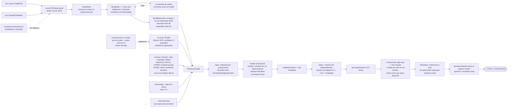
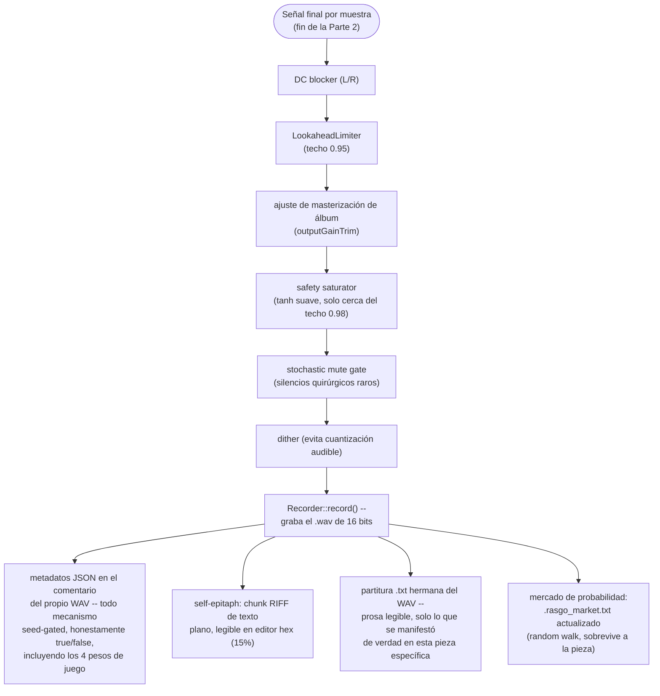

# Rasgo Synth -- diagrama de flujo de arquitectura (base phase84, actualización operativa 2026-08-22)

Reemplaza el diagrama Mermaid publicado como artifact en la fase 38 (y la
versión ilustrada/blueprint rediseñada después, ambas fuera del
repositorio -- esta sesión no tiene acceso a la herramienta de publicar
artifact, así que esta versión vive como archivo versionado, lo que tiene
la ventaja de nunca más quedar desactualizada en silencio). Cinco partes:
decisiones por semilla, flujo de señal por muestra, cadena de
masterización, clasificación de los mecanismos, y mapa de entrecruzamiento/
simbiosis entre ellos. Actualizado de phase76 a phase84 -- Harmonàig/
polifonía de crivos/Bloom (77-79), pesos de juego de Caillois (80, ahora un
hub propio de sesgo cruzado, ver Parte 5), aksak/crivo rítmico (82), y
Cortocircuito (84).

Cada mecanismo citado tiene su fase de origen entre paréntesis -- consulte
[`Plano_de_Upgrade_Instrumento_Generativo.md`](../../Plano_de_Upgrade_Instrumento_Generativo.md)
para la historia completa de cualquiera de ellos (documento solo en
portugués, la fuente de verdad del proyecto).

El diagrama de phase84 sigue siendo la base estructural. Las fases 118-123
añadieron agencia material, ecología de audibilidad después del espacio,
orquestación relacional y memoria; la referencia y la continuidad actuales
describen esas adiciones sin duplicar cada conexión del flujo.

## Parte 1 -- lo que la semilla decide, una vez, al inicio de la pieza

```mermaid
flowchart TB
    SEED(["Semilla (cfg.seed)"]) --> RNG["std::mt19937 rng(seed)"]

    RNG --> CAILLOIS
    RNG --> ESCALA
    RNG --> RITMO
    RNG --> ARMONIA
    RNG --> TEXTURA
    RNG --> ESTRUCTURA
    RNG --> RARO
    RNG --> GARANTIA

    subgraph CAILLOIS["Pesos de juego de Caillois (fase 80)"]
        direction TB
        C1["4-simplex via stick-breaking:\nAlea/Agon/Ilinx/Mimicry"]
        C2["sesga (nunca fuerza) once\nmecanismos existentes -- ver Parte 5"]
    end

    subgraph ESCALA["Escala"]
        direction TB
        E1["catálogo de 39 escalas (por defecto)"]
        E2["O escala crivo de Xenakis generada,\nno catalogada (12%, fase 61,\nmercado de probabilidad)"]
        E3["blend secundario del catálogo (40%)"]
        E4["modulación modal (fase 33) O\nmodulación tonal (fase 32/48) --\nmutuamente exclusivas"]
    end

    subgraph ARMONIA["Armonía/melodía"]
        direction TB
        H1["peso funcional en tiempo fuerte (50%, fase 29)"]
        H2["progresión de acorde fija I-IV-V... (50%)"]
        H3["O Neo-Riemanniano P/L/R,\ntríada real vagando (35% de H2, fase 65)"]
        H4["conducción de voz por índice de grado\n(closenessFactor, por defecto)"]
        H5["O conducción de voz real por semitono,\nmezcla 80/15/5% (20%, fase 62)"]
        H6["entonación libre (el caos empuja el pitch\nfuera de la escala) -- acoplada\nINVERSAMENTE al ritmo vía Heisenberg\n(25%, fase 71)"]
        H7["Harmonàig -- pad de 4 voces reales\n(raíz/3ra/5ta/7ma), solo con progresión de\nacorde activa, sesgado por Agon\n(fase 77)"]
    end

    subgraph RITMO["Ritmo/percusión"]
        direction TB
        R1["divisor XOR (CGS22) -- bombo/caja/\nhi-hat/cowbell/clap/tom/platillo/maracas"]
        R2["cowbell: XOR estándar O euclidiano\nreal Bjorklund/Toussaint (25%, fase 57)"]
        R3["O arquetipo entre 8 opciones (5 nombrados\n+ 2 aksak balcánicos reales + 1 crivo\nrítmico de Xenakis generado), re-sorteado\nen cada sección del arco (fases 67/82,\nmercado de probabilidad)"]
        R4["dirección de paso caótico -- puntero\nde la MELODÍA (no de la percusión) leído\npor StandardMap dedicado (15%, fase 64,\nmercado de probabilidad)"]
        R5["humanización rítmica (~50%) --\nacoplada INVERSAMENTE a la afinación\nvía Heisenberg (fase 71)"]
        R6["contagio del caos: decay de bombo/caja/\nhi-hat con jitter por golpe"]
        R7["ratchet en los toms, sustain extendido\nen el platillo (por golpe, no por pieza)"]
        R8["batería como instrumento real:\npresencia ligada a la densidad del arco,\n12% sin batería, fallas reales por golpe\nen 35% de las piezas (fase 66,\nmercado de probabilidad)"]
    end

    subgraph TEXTURA["Texturas de fondo"]
        direction TB
        T1["Gendyn (Xenakis), ruido coloreado,\nAtari Punk, AY8910 arpegio, Ochd LFOs"]
        T2["Oscilador Walsh -- base ortogonal +-1,\nHadamard/sequency (30%, fase 59,\nmercado de probabilidad)"]
        T3["hocketing aditivo (40%)"]
        T4["O cascada polifónica -- Shifty real,\nregistro de desplazamiento (35% de T3,\nmezclado con diodo, fase 63, mercado de\nprobabilidad)"]
        T5["nube granular de la propia pieza"]
        T6["VOSIM -- 6º principio de síntesis,\nráfagas sin² decayendo (20%, fase 72)"]
        T7["Vector Synthesis -- crossfade 2D real\n(inspirado en Prophet VS) entre banco\ndedicado Gendyn/Walsh/AtariPunk/ruido,\nposición por 2 mapas de caos (20%,\nfase 76)"]
        T8["latido binaural caótico -- L/R\ndivergen en frecuencia de verdad\n(20%, fase 73)"]
        T9["polifonía de crivos de Xenakis --\n4 canales independientes (madera/soplo,\nmetal/vidrio, agua, plasma reactivo),\nsesgado por Agon (20%, fase 78)"]
        T10["Bloom -- melodía fractal Trunk/Branch/\nPath, trunk reaplicado sobre sí mismo\n(22%, fase 79)"]
    end

    subgraph ESTRUCTURA["Arco/estructura"]
        direction TB
        S1["plantilla narrativa: dramatic O\nkishotenketsu (cadena de Markov)"]
        S2["tempo variable discreto +\nritardando real en la coda"]
        S2b["O accelerando/stringendo hacia el\nclímax -- el ritardando tiene la palabra\nfinal en la coda (fase 68, mercado de\nprobabilidad)"]
        S3["muerte térmica: desvanecimiento lento O\ncorte abrupto al final -- sesgado\npor Ilinx"]
        S4["colapso de Rössler, self-epitaph,\narchivo apócrifo, stochastic mute --\nsesgados por Ilinx/Mimicry"]
        S5["Paréntesis -- redirección real del\naudio final a un loop de tartamudeo\ncapturado, retorno exacto, sesgado\npor Mimicry (20%, fase 70)"]
    end

    subgraph RARO["Mecanismos raros/ruptura"]
        direction TB
        X1["Agon -- 4 voces compitiendo por poder\n(principal/atari/gendyn/tuba), sesgado\npor Agon (30%)"]
        X2["elemento extraño interno (15%) +\nversión literal, lee CPU real (25%) --\nrompe la reproducibilidad cuando dispara,\nsesgado por Mimicry"]
        X3["overflow Q1.15, spectral ghost,\nsample-hold glitch -- 15% cada uno"]
        X4["contaminación cruzada: pico de audio\nreal empuja el divisor de reloj (25%,\nfase 60, mercado de probabilidad)"]
        X5["fracture folder, rungler,\nleibniz rectifier -- sesgados por Ilinx"]
        X6["filtro Polivoks -- 3er color, auto-\noscilación genuina (damping negativo +\ntanh), mutuamente exclusivo con\nSallenKeyFilter en el mismo slot (25%,\nfase 75)"]
        X7["envolvente de asfixia por sidechain --\nel bombo cierra el filtro, recovery\nexponencial (25%, fase 74)"]
        X8["Cortocircuito -- corte seco real\n(gate + chispa) + re-sorteo forzado\nde 6 mecanismos que quedaron apagados,\nsesgado por Ilinx, evento único por\npieza (fase 84)"]
    end

    subgraph GARANTIA["Red de seguridad (fase 40)"]
        direction TB
        G1["si apócrifo + entonación libre +\nmodulación tonal + self-feedback\ntodos salieron 'no' por azar..."]
        G2["...uno de ellos es forzado --\ntoda pieza pone a prueba 1 límite real"]
        G1 --> G2
    end
```

## Parte 2 -- flujo de señal, una muestra a la vez

## Parte 3 -- cadena de masterización

## Parte 4 -- clasificación de los mecanismos

No es una lista exhaustiva de todos los mecanismos del motor (eso
duplicaría el `Plano_de_Upgrade_Instrumento_Generativo.md` entero) -- es
una clasificación por **tipo estructural**, la pregunta "qué especie de
decisión es esta, y con qué compite o no compite". Todo mecanismo del
motor cae en una (o más de una) de estas cinco categorías:

### A. Elección estructural única (corre una vez, decide entre alternativas mutuamente excluyentes)

La semilla decide una bifurcación y solo uno de los lados existe en toda
la pieza -- nunca los dos a la vez, disciplina de "un modo limpio, no
capas" de este proyecto.

| Mecanismo (fase) | Alternativa mutuamente exclusiva |
|---|---|
| Filtro Polivoks (75) | SallenKeyFilter -- mismo slot de crossfade con MoogFilter |
| Neo-Riemanniano P/L/R (65) | Progresión de acordes fija I-IV-V... |
| Conducción de voz por semitono (62) | Conducción de voz por índice de grado (por defecto) |
| Escala crivo de Xenakis (61) | Catálogo de 39 escalas (por defecto) |
| Arquetipo rítmico de 16 pasos (67/82) | Divisor XOR estándar para bombo/caja/hi-hat |
| Cowbell euclidiano (57) | Cowbell vía divisor XOR estándar |
| Modulación modal (33) | Modulación tonal (32/48) |
| Cascada polifónica/Shifty (63) | Hocketing aditivo simple (37) |
| Ritardando de coda (48) | Accelerando/stringendo (68) -- el ritardando gana si la coda llega de verdad |
| Escala por pieza (48) | Ya no forzada por tema de álbum (fase 83) -- toda pieza, álbum o no, sortea la propia |

### B. Capa aditiva independiente (se enciende/apaga, no compite por un "slot")

Se mezcla continuamente cuando está habilitada, junto con cualquier otra
cosa que esté sucediendo -- no hay conflicto, solo presencia o ausencia.

Ejemplos: Oscilador Walsh (59), VOSIM (72), Vector Synthesis (76), latido
binaural caótico (73), tuba/voz de soplo (43), nube granular, ring
modulator, multiband bloom, ratchet de toms/sustain de platillo (56),
Harmonàig (77, condicionado a progresión de acorde activa), polifonía de
crivos de Xenakis (78), Bloom (79).

### C. Acoplamiento cruzado directo (la salida de un mecanismo modula el parámetro/estado de otro)

El punto más "vivo" de la arquitectura -- donde un mecanismo no es solo un
efecto aislado, sino que genuinamente alimenta a otro. Ver mapa completo
en la Parte 5.

Ejemplos: contaminación cruzada (60, pico de audio -> pulso extra en el
divisor de reloj), asfixia por sidechain (74, bombo -> corte del filtro),
Heisenberg (71, un balance -> ritmo Y afinación en direcciones opuestas),
Vector Synthesis (76, dos mapas de caos -> posición X/Y del crossfade),
Agon (49, estancamiento de la melodía -> redistribución de poder entre 4
voces), pesos de juego de Caillois (80, cuatro pesos -> sesgo de
probabilidad de once mecanismos), trayectoria de álbum (83, dos puntos
del símplex -> punto interpolado por pista).

### D. Estado persistente entre renders (sobrevive al final de la pieza)

Categoría rara -- la abrumadora mayoría del motor es 100% determinista a
partir de la semilla, sin memoria entre ejecuciones. Solo dos
excepciones, ambas documentadas con honestidad explícita en el JSON:

- **Elemento extraño, versión literal (50-51)**: lee temperatura/carga
  real de la CPU en el momento del render -- la misma semilla puede
  producir piezas levemente diferentes.
- **Mercado de probabilidades (69)**: ocho mecanismos recientes (ver
  tabla en la Parte 5) cambian probabilidad fija por un "precio" con
  random walk y reversión a la media, persistido en
  `.rasgo_market.txt`, acotado 0.03-0.97.

### E. Red de garantía / activación forzada (dispara en reacción a otros mecanismos)

Dos mecanismos usan el mismo idioma -- activar una bandera y configurar
el objeto al instante -- pero por gatillos opuestos:

- **Garantía de límite (fase 40)**: observa si apócrifo + entonación
  libre + modulación tonal + self-feedback salieron todos "no" por
  azar, y fuerza uno de ellos ANTES de que comience el bucle principal
  -- toda pieza pone a prueba de verdad al menos un mecanismo de
  riesgo.
- **Cortocircuito (fase 84)**: a MITAD de la pieza, un corte seco real
  dispara y, en el mismo instante, da una segunda oportunidad elevada
  (40% cada uno) a seis mecanismos que ya habían sorteado "no" al
  inicio (apócrifo, entonación libre, modulación tonal, self-feedback,
  rungler, elemento extraño) -- mismo idioma de activación forzada,
  pero reaccionando a una ruptura, no a una ausencia total de riesgo.

## Parte 5 -- mapa de entrecruzamiento y simbiosis

Grafo de los acoplamientos reales (categoría C arriba) -- qué mecanismo
lee o altera el estado de cuál otro, distinto de la Parte 2 (que es solo
el camino de la señal de audio muestra a muestra).

```mermaid
flowchart TB
    subgraph MAPS["Mapas de caos compartidos (9 en total)"]
        direction LR
        CHAOS["Henon/Lato/Standard/Gbman/Cusp/\nQuad/Rossler/StandardMap dedicado"]
    end

    CHAOS --> FILTROCROSS["crossfade Moog<->2do color (GbmanMap)"]
    CHAOS --> VECTORPOS["posición X/Y del Vector Synthesis\n(2 mapas independientes, fase 76)"]
    CHAOS --> STEPADDR["dirección de paso caótico de la melodía\n(StandardMap dedicado, fase 64)"]
    CHAOS --> GRANJIT["jitter de pitch del granular (QuadMap)"]
    CHAOS --> ROSSCOLL["colapso rossler -- espiral que\nerupciona en golpe de filtro (fase 46)"]
    CHAOS --> BINAURAL["desvío de frecuencia L/R\n(latido binaural, fase 73)"]
    CHAOS --> SIEVECLOCK["relojes independientes de los 4 crivos\nde Xenakis (Lorenz, fase 78)"]

    subgraph GAMEWEIGHTS["Pesos de juego de Caillois (fase 80)\n-- hub de sesgo cruzado"]
        direction TB
        GW["Alea / Agon / Ilinx / Mimicry\n(4-simplex, stick-breaking)"]
    end

    GW -.sesga.-> GWAGON["Agon, Harmonàig,\npolifonía de crivos"]
    GW -.sesga.-> GWILINX["Rungler, Rossler, muerte térmica,\nself-feedback, stochastic mute,\nLeibniz, Cortocircuito (84)"]
    GW -.sesga.-> GWMIMICRY["apócrifo, self-epitaph,\nseñal extranjera, paréntesis,\nelemento extraño"]
    GW -.trayectoria por pista.-> GWALBUM["AlbumRenderer: punto\ninterpolado en el símplex\npor pista (fase 83)"]

    KICK["golpe real de bombo (percusión)"] -.dispara.-> ASFIXIA["asfixia: cierra el filtro,\nrecovery exponencial (fase 74)"]
    ASFIXIA -.multiplica.-> CUTOFF["cutoff del filtro principal"]

    PEAKFOLLOW["seguidor de pico rápido\n(audio real, no el promedio lento\ndel self-feedback)"] -.excede umbral.-> CONTAGION2["contaminación cruzada\n(fase 60)"]
    CONTAGION2 -.pulso extra.-> CLOCKDIV["divisor de reloj XOR\ncompartido (percusión)"]

    HEISBAL["balance Heisenberg\n(único valor derivado de la semilla, fase 71)"]
    HEISBAL -.sube.-> HUMANIZE["humanizeMaxSamples\n(precisión RÍTMICA se afloja)"]
    HEISBAL -.sube, efecto inverso.-> INTONATION["freeIntonationDepth\n(precisión de AFINACIÓN se traba)"]

    MELSTALE["melodía detectada como estancada"] -.arma.-> AGONTRIG["Agon: disputa de poder\n(fase 49)"]
    AGONTRIG -.redistribuye proporcional.-> VOICES["principal/atari/gendyn/tuba\n(cada uno cede según su propia distancia\nde la ganadora)"]

    MARKETSTATE[(".rasgo_market.txt\n(random walk persistido)")]
    MARKETSTATE -.precio usado en esta pieza.-> M1["generatedScale (12%)"]
    MARKETSTATE -.-> M2["chaosStepAddress (15%)"]
    MARKETSTATE -.-> M3["hocketCascade (35%)"]
    MARKETSTATE -.-> M4["walshOscillator (30%)"]
    MARKETSTATE -.-> M5["crossDomainContagion (25%)"]
    MARKETSTATE -.-> M6["drumsEnabled (88%)"]
    MARKETSTATE -.-> M7["drumArchetype (35%)"]
    MARKETSTATE -.-> M8["accelerando (40%)"]
    M1 -.settle tras la pieza.-> MARKETSTATE
    M8 -.settle tras la pieza.-> MARKETSTATE

    GUARANTEE1["apócrifo + entonación libre +\nmodulación tonal + self-feedback"] -.todos 'no'?.-> GUARANTEE2["fuerza 1 de ellos\n(fase 40)"]

    CURTOFIRE["Cortocircuito dispara\n(fase 84)"] -.corte seco real.-> CURTOGATE["gate + chispa de ruido\n(~3ms rampa)"]
    CURTOFIRE -.re-sorteo 40% cada uno.-> CURTOCRASH["apócrifo, entonación libre,\nmodulación tonal, self-feedback,\nrungler, elemento extraño"]
```

## Nota sobre honestidad

Todo mecanismo seed-gated arriba aparece en el JSON de metadatos y en la
partitura `.txt` como `true`/`false` reales -- nunca "presente pero nunca
probado". La disciplina de este proyecto (ver `feedback_rasgo_quality_bar`
y el historial de bugs atrapados por *verificación empírica*, no solo
compilación limpia) es: todo mecanismo nuevo se audita en una muestra de
piezas renderizadas antes de considerarse listo, contando cuántas veces
el campo aparece como `true` y comparándolo con la probabilidad esperada
-- incluyendo, en la fase 76, un bug de *proceso* atrapado de esta forma
(binario desactualizado sin el código nuevo, denunciado por una tasa de
disparo estadísticamente imposible antes de que ningún oído humano
necesitara notarlo), y en la fase 84, una auditoría real en 22 piezas
confirmando que el Cortocircuito dispara y listando por nombre qué
mecanismos entraron colados.

El mercado de probabilidades (fase 69, Parte 5 arriba) es la única
categoría donde la probabilidad *en sí* no es fija -- pero el valor
realmente usado en cada pieza sigue expuesto en el JSON (`marketPrices`),
así que la honestidad de la auditoría no se ve comprometida por esto.
