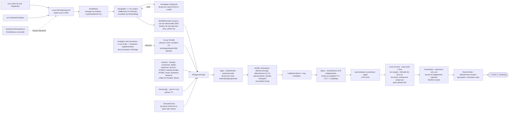
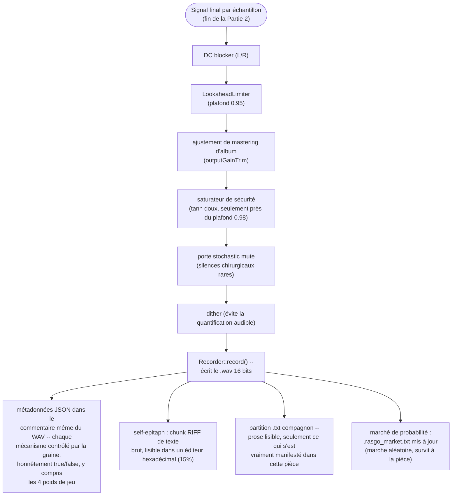

# Rasgo Synth -- organigramme d'architecture (base phase84, mise à jour opérationnelle 2026-08-22)

Remplace l'organigramme Mermaid publié comme artefact en phase 38 (et la
version illustrée/blueprint redessinée ensuite, toutes deux hors du dépôt --
cette session n'a pas accès à un outil de publication d'artefact, donc cette
version vit comme un fichier versionné, ce qui a l'avantage de ne plus jamais
devenir obsolète silencieusement). Cinq parties : choix au moment de la
graine, flux du signal par échantillon, chaîne de mastering, classification
des mécanismes, et carte de recoupement/symbiose entre eux. Mis à jour de
phase76 à phase84 -- Harmonàig/polyphonie de cribles/Bloom (77-79), poids de
jeu de Caillois (80, désormais son propre hub de biais croisé, voir Partie 5),
aksak/crible rythmique (82), et Curto-Circuito (« Court-Circuit », 84).

Chaque mécanisme cité porte sa phase d'origine entre parenthèses -- voir
[`Plano_de_Upgrade_Instrumento_Generativo.md`](../../Plano_de_Upgrade_Instrumento_Generativo.md)
(portugais uniquement) pour l'histoire complète de chacun d'eux.

Le diagramme de phase84 reste la base structurelle. Les phases 118-123 ont
ajouté l'agence matérielle, l'écologie d'audibilité après espace,
l'orchestration relationnelle et la mémoire ; la référence et la continuité
actuelles décrivent ces ajouts sans dupliquer chaque liaison du flux.

## Partie 1 -- ce que la graine décide, une fois, au début de la pièce

```mermaid
flowchart TB
    SEED(["Graine (cfg.seed)"]) --> RNG["std::mt19937 rng(seed)"]

    RNG --> CAILLOIS
    RNG --> GAMME
    RNG --> RYTHME
    RNG --> HARMONIE
    RNG --> TEXTURE
    RNG --> STRUCTURE
    RNG --> RARE
    RNG --> GARANTIE

    subgraph CAILLOIS["Poids de jeu de Caillois (phase 80)"]
        direction TB
        C1["4-simplexe via stick-breaking :\nAlea/Agon/Ilinx/Mimicry"]
        C2["influence (sans jamais forcer) onze\nmécanismes existants -- voir Partie 5"]
    end

    subgraph GAMME["Gamme"]
        direction TB
        E1["catalogue de 39 gammes (défaut)"]
        E2["OU gamme crible de Xenakis générée,\nnon cataloguée (12%, phase 61,\nmarché de probabilité)"]
        E3["mélange secondaire du catalogue (40%)"]
        E4["modulation modale (phase 33) OU\nmodulation tonale (phase 32/48) --\nmutuellement exclusives"]
    end

    subgraph HARMONIE["Harmonie/mélodie"]
        direction TB
        H1["poids fonctionnel sur temps forts\n(50%, phase 29)"]
        H2["progression d'accords fixe I-IV-V... (50%)"]
        H3["OU néo-riemannien P/L/R,\nvraie triade errante (35% de H2, phase 65)"]
        H4["conduite de voix par indice de degré\n(closenessFactor, défaut)"]
        H5["OU vraie conduite de voix par demi-ton,\nmélange 80/15/5% (20%, phase 62)"]
        H6["intonation libre (le chaos pousse la\nhauteur hors de la gamme) -- couplée\nINVERSEMENT au rythme via Heisenberg\n(25%, phase 71)"]
        H7["Harmonàig -- vrai pad à 4 voix\n(fondamentale/3ce/5te/7me), seulement\navec une progression d'accords active,\ninfluencé par Agon (phase 77)"]
    end

    subgraph RYTHME["Rythme/percussion"]
        direction TB
        R1["diviseur XOR (CGS22) -- grosse caisse/\ncaisse claire/charleston/cowbell/clap/\ntom/cymbale/maracas"]
        R2["cowbell : XOR défaut OU vrai rythme\neuclidien Bjorklund/Toussaint (25%, phase 57)"]
        R3["OU un des 8 archétypes (5 nommés\n+ 2 aksak balkaniques réels + 1 crible\nrythmique de Xenakis généré), retiré au\nsort à chaque section de l'arc (phases\n67/82, marché de probabilité)"]
        R4["lecture de pas adressée par le chaos --\nle pointeur de la MÉLODIE (pas de la\npercussion) lu par un StandardMap\ndédié (15%, phase 64, marché de\nprobabilité)"]
        R5["humanisation rythmique (~50%) --\ncouplée INVERSEMENT à la précision\nde hauteur via Heisenberg (phase 71)"]
        R6["contagion du chaos : decay de grosse\ncaisse/caisse claire/charleston jitteré\npar coup"]
        R7["ratchets sur les toms, sustain de\ncymbale étendu (par coup, pas par pièce)"]
        R8["batterie comme un vrai instrument :\nprésence liée à la densité de l'arc,\n12% sans batterie, vrais échecs par\ncoup dans 35% des pièces (phase 66,\nmarché de probabilité)"]
    end

    subgraph TEXTURE["Textures de fond"]
        direction TB
        T1["Gendyn (Xenakis), bruit coloré,\nAtari Punk, arpège AY8910, LFOs Ochd"]
        T2["Oscillateur Walsh -- base orthogonale\n+-1, Hadamard/sequency (30%, phase 59,\nmarché de probabilité)"]
        T3["hocketing additif (40%)"]
        T4["OU cascade polyphonique -- vrai Shifty,\nregistre à décalage (35% de T3,\nmixé par diode, phase 63, marché de\nprobabilité)"]
        T5["nuage granulaire de la pièce elle-même"]
        T6["VOSIM -- 6e principe de synthèse,\nimpulsions sin² décroissantes (20%, phase 72)"]
        T7["Vector Synthesis -- vrai crossfade 2D\n(inspiré du Prophet VS) à travers un\nbanc dédié Gendyn/Walsh/AtariPunk/bruit,\nposition par 2 cartes de chaos (20%,\nphase 76)"]
        T8["battement binaural chaotique -- L/R\ndivergent réellement en fréquence\n(20%, phase 73)"]
        T9["polyphonie de cribles de Xenakis --\n4 canaux indépendants (bois/souffle,\nmétal/verre, eau, plasma réactif),\ninfluencé par Agon (20%, phase 78)"]
        T10["Bloom -- mélodie fractale Trunk/Branch/\nPath, trunk réappliqué à lui-même\n(22%, phase 79)"]
    end

    subgraph STRUCTURE["Arc/structure"]
        direction TB
        S1["gabarit narratif : dramatic OU\nkishotenketsu (chaîne de Markov)"]
        S2["variation discrète de tempo +\nvrai ritardando de coda"]
        S2b["OU accelerando/stringendo vers le\nclimax -- le ritardando a le dernier\nmot dans la coda (phase 68, marché\nde probabilité)"]
        S3["mort thermique : fondu lent OU\ncoupure abrupte à la fin -- influencé\npar Ilinx"]
        S4["effondrement de rossler, self-epitaph,\ndéchirure apocryphe, stochastic mute --\ninfluencés par Ilinx/Mimicry"]
        S5["Parenthèse -- vraie redirection de\nl'audio final vers une boucle de\nbégaiement capturée, retour exact,\ninfluencé par Mimicry (20%, phase 70)"]
    end

    subgraph RARE["Mécanismes rares/rupture"]
        direction TB
        X1["Agon -- 4 voix en compétition pour\nle pouvoir (main/atari/gendyn/tuba),\ninfluencé par Agon (30%)"]
        X2["élément étrange interne (15%) +\nversion littérale, lit le vrai CPU\n(25%) -- brise la reproductibilité\nquand il se déclenche, influencé\npar Mimicry"]
        X3["débordement Q1.15, spectral ghost,\nsample-hold glitch -- 15% chacun"]
        X4["contagion inter-domaines : un vrai\npic audio pousse le diviseur d'horloge\n(25%, phase 60, marché de probabilité)"]
        X5["fracture folder, rungler,\nleibniz rectifier -- influencés par Ilinx"]
        X6["filtre Polivoks -- 3e couleur, vraie\nauto-oscillation (damping négatif +\ntanh), mutuellement exclusif avec\nSallenKeyFilter dans le même\nemplacement (25%, phase 75)"]
        X7["enveloppe d'asphyxie par sidechain --\nla grosse caisse ferme le filtre,\nrécupération exponentielle (25%,\nphase 74)"]
        X8["Curto-Circuito -- vraie coupure sèche\n(porte + étincelle) + nouveau tirage\nforcé de 6 mécanismes désactivés,\ninfluencé par Ilinx, événement unique\npar pièce (phase 84)"]
    end

    subgraph GARANTIE["Filet de sécurité (phase 40)"]
        direction TB
        G1["si apocryphe + intonation libre +\nmodulation tonale + self-feedback\nsont tous sortis 'non' par hasard..."]
        G2["...l'un d'eux est forcé --\nchaque pièce teste 1 vraie limite"]
        G1 --> G2
    end
```

## Partie 2 -- flux du signal, un échantillon à la fois

## Partie 3 -- chaîne de mastering

## Partie 4 -- classification des mécanismes

Pas une liste exhaustive de tous les mécanismes du moteur (cela dupliquerait
tout le `Plano_de_Upgrade_Instrumento_Generativo.md`) -- c'est une
classification par **type structurel**, la question « quelle espèce de
décision est-ce, et avec quoi rivalise-t-elle ou non ». Chaque mécanisme du
moteur entre dans une (ou plusieurs) de ces cinq catégories :

### A. Choix structurel unique (s'exécute une fois, décide entre des alternatives qui s'excluent)

La graine décide d'une bifurcation et un seul des côtés existe pour toute la
pièce -- jamais les deux à la fois, la discipline propre à ce projet de
« un mode propre, pas des couches ».

| Mécanisme (phase) | Alternative mutuellement exclusive |
|---|---|
| Filtre Polivoks (75) | SallenKeyFilter -- même emplacement de crossfade avec MoogFilter |
| Néo-riemannien P/L/R (65) | Progression d'accords fixe I-IV-V... |
| Conduite de voix par demi-ton (62) | Conduite de voix par indice de degré (défaut) |
| Gamme crible de Xenakis (61) | Catalogue de 39 gammes (défaut) |
| Archétype rythmique à 16 pas (67/82) | Diviseur XOR par défaut pour grosse caisse/caisse claire/charleston |
| Cowbell euclidien (57) | Cowbell via le diviseur XOR par défaut |
| Modulation modale (33) | Modulation tonale (32/48) |
| Cascade polyphonique/Shifty (63) | Hocketing additif simple (37) |
| Ritardando de coda (48) | Accelerando/stringendo (68) -- le ritardando l'emporte si la coda arrive vraiment |
| Gamme par pièce (48) | Plus imposée par un thème d'album (phase 83) -- chaque pièce, album ou non, tire la sienne |

### B. Couche additive indépendante (activée/désactivée, ne rivalise pas pour un « emplacement »)

Se mélange continuellement quand activée, avec tout ce qui se passe par
ailleurs -- aucun conflit, seulement présence ou absence.

Exemples : Oscillateur Walsh (59), VOSIM (72), Vector Synthesis (76),
battement binaural chaotique (73), voix de tuba/souffle (43), nuage
granulaire, ring modulator, multiband bloom, ratchet de toms/sustain de
cymbale (56), Harmonàig (77, conditionné à une progression d'accords
active), polyphonie de cribles de Xenakis (78), Bloom (79).

### C. Couplage croisé direct (la sortie d'un mécanisme module le paramètre/état d'un autre)

Le point le plus « vivant » de l'architecture -- où un mécanisme n'est pas
seulement un effet isolé, mais nourrit réellement un autre. Voir la carte
complète en Partie 5.

Exemples : contagion inter-domaines (60, pic audio -> impulsion
supplémentaire dans le diviseur d'horloge), asphyxie par sidechain (74,
grosse caisse -> cutoff du filtre), Heisenberg (71, un équilibre -> rythme
ET hauteur dans des directions opposées), Vector Synthesis (76, deux cartes
de chaos -> position X/Y du crossfade), Agon (49, stagnation mélodique ->
redistribution de pouvoir entre 4 voix), poids de jeu de Caillois (80,
quatre poids -> biais de probabilité pour onze mécanismes), trajectoire
d'album (83, deux points du simplexe -> un point interpolé par piste).

### D. État persisté entre les rendus (survit à la fin de la pièce)

Catégorie rare -- l'écrasante majorité du moteur est 100% déterministe à
partir de la graine, sans mémoire entre les exécutions. Seulement deux
exceptions, toutes deux honnêtement documentées dans le JSON :

- **Élément étrange, version littérale (50-51)** : lit la vraie
  température/charge du CPU au moment du rendu -- la même graine peut
  produire des pièces légèrement différentes.
- **Marché de probabilités (69)** : huit mécanismes récents (voir le
  tableau en Partie 5) échangent une probabilité fixe contre un « prix »
  avec une marche aléatoire à retour à la moyenne, persisté dans
  `.rasgo_market.txt`, borné 0.03-0.97.

### E. Filet de sécurité / activation forcée (se déclenche en réaction à d'autres mécanismes)

Deux mécanismes utilisent le même idiome -- basculer un drapeau et
configurer l'objet sur-le-champ -- mais par des déclencheurs opposés :

- **Garantie d'intensité (phase 40)** : vérifie si apocryphe + intonation
  libre + modulation tonale + self-feedback sont tous sortis « non » par
  hasard, et force l'un d'eux AVANT même que la boucle principale ne
  commence -- chaque pièce teste vraiment au moins un mécanisme de risque.
- **Curto-Circuito (phase 84)** : au MILIEU de la pièce, une vraie coupure
  sèche se déclenche et, au même instant, donne une seconde chance élevée
  (40% chacun) à six mécanismes qui avaient déjà été tirés « non » au
  début (apocryphe, intonation libre, modulation tonale, self-feedback,
  rungler, élément étrange) -- le même idiome d'activation forcée, mais
  réagissant à une rupture, pas à une absence totale de risque.

## Partie 5 -- carte de recoupement et de symbiose

Un graphe des couplages réels (catégorie C ci-dessus) -- quel mécanisme lit
ou modifie l'état de quel autre, distinct de la Partie 2 (qui n'est que le
chemin du signal audio lui-même, échantillon par échantillon).

```mermaid
flowchart TB
    subgraph MAPS["Cartes de chaos partagées (9 au total)"]
        direction LR
        CHAOS["Henon/Lato/Standard/Gbman/Cusp/\nQuad/Rossler/StandardMap dédié"]
    end

    CHAOS --> FILTERCROSS["crossfade Moog<->2e couleur (GbmanMap)"]
    CHAOS --> VECTORPOS["position X/Y de Vector Synthesis\n(2 cartes indépendantes, phase 76)"]
    CHAOS --> STEPADDR["pas adressé par le chaos de la mélodie\n(StandardMap dédié, phase 64)"]
    CHAOS --> GRANJIT["gigue de hauteur granulaire (QuadMap)"]
    CHAOS --> ROSSCOLL["effondrement rossler -- une spirale\nqui fait éruption en un coup de filtre\n(phase 46)"]
    CHAOS --> BINAURAL["divergence de fréquence L/R\n(battement binaural, phase 73)"]
    CHAOS --> SIEVECLOCK["horloges indépendantes des 4 canaux\nde crible de Xenakis (Lorenz, phase 78)"]

    subgraph GAMEWEIGHTS["Poids de jeu de Caillois (phase 80)\n-- hub de biais croisé"]
        direction TB
        GW["Alea / Agon / Ilinx / Mimicry\n(4-simplexe, stick-breaking)"]
    end

    GW -.influence.-> GWAGON["Agon, Harmonàig,\npolyphonie de cribles"]
    GW -.influence.-> GWILINX["Rungler, Rossler, thermal fade,\nself-feedback, stochastic mute,\nLeibniz, Curto-Circuito (84)"]
    GW -.influence.-> GWMIMICRY["apocryphe, self-epitaph,\nsignal étranger, parenthèse,\nélément étrange"]
    GW -.trajectoire par piste.-> GWALBUM["AlbumRenderer : point\ninterpolé sur le simplexe\npar piste (phase 83)"]

    KICK["vrai coup de grosse caisse (percussion)"] -.déclenche.-> ASPHYXIA["asphyxie : ferme le filtre,\nrécupération exponentielle (phase 74)"]
    ASPHYXIA -.multiplie.-> CUTOFF["cutoff du filtre principal"]

    PEAKFOLLOW["suiveur de pic rapide\n(audio réel, pas la moyenne lente\ndu self-feedback)"] -.dépasse le seuil.-> CONTAGION2["contagion inter-domaines\n(phase 60)"]
    CONTAGION2 -.impulsion supplémentaire.-> CLOCKDIV["diviseur d'horloge XOR\npartagé (percussion)"]

    HEISBAL["équilibre Heisenberg\n(une seule valeur dérivée de la graine, phase 71)"]
    HEISBAL -.monte.-> HUMANIZE["humanizeMaxSamples\n(précision RYTHMIQUE se relâche)"]
    HEISBAL -.monte, effet inverse.-> INTONATION["freeIntonationDepth\n(précision de HAUTEUR se verrouille)"]

    MELSTALE["mélodie détectée comme stagnante"] -.arme.-> AGONTRIG["Agon : dispute de pouvoir\n(phase 49)"]
    AGONTRIG -.redistribue proportionnellement.-> VOICES["main/atari/gendyn/tuba\n(chacune cède en proportion de sa\npropre distance par rapport à la\ngagnante)"]

    MARKETSTATE[(".rasgo_market.txt\n(marche aléatoire persistée)")]
    MARKETSTATE -.prix utilisé pour cette pièce.-> M1["generatedScale (12%)"]
    MARKETSTATE -.-> M2["chaosStepAddress (15%)"]
    MARKETSTATE -.-> M3["hocketCascade (35%)"]
    MARKETSTATE -.-> M4["walshOscillator (30%)"]
    MARKETSTATE -.-> M5["crossDomainContagion (25%)"]
    MARKETSTATE -.-> M6["drumsEnabled (88%)"]
    MARKETSTATE -.-> M7["drumArchetype (35%)"]
    MARKETSTATE -.-> M8["accelerando (40%)"]
    M1 -.se stabilise après la pièce.-> MARKETSTATE
    M8 -.se stabilise après la pièce.-> MARKETSTATE

    GUARANTEE1["apocryphe + intonation libre +\nmodulation tonale + self-feedback"] -.tous 'non' ?.-> GUARANTEE2["force l'un d'eux\n(phase 40)"]

    CURTOFIRE["Curto-Circuito se déclenche\n(phase 84)"] -.vraie coupure sèche.-> CURTOGATE["porte + étincelle de bruit\n(~3ms de rampe)"]
    CURTOFIRE -.nouveau tirage 40% chacun.-> CURTOCRASH["apocryphe, intonation libre,\nmodulation tonale, self-feedback,\nrungler, élément étrange"]
```

## Une note sur l'honnêteté

Chaque mécanisme contrôlé par la graine ci-dessus apparaît dans le JSON de
métadonnées et dans la partition `.txt` comme un vrai `true`/`false` --
jamais « présent mais jamais testé ». La discipline de ce projet (voir
l'historique des bugs attrapés par *vérification empirique*, pas seulement
une compilation propre) est : chaque nouveau mécanisme est audité sur un
lot de pièces rendues avant d'être considéré comme terminé, en comptant
combien de fois le champ apparaît comme `true` et en comparant avec la
probabilité attendue -- y compris, en phase 76, un bug de *processus*
attrapé de cette façon (un binaire obsolète sans le code de la nouvelle
phase, dénoncé par un taux de déclenchement statistiquement impossible
avant même qu'une oreille humaine n'ait besoin de le remarquer), et en
phase 84, un vrai audit sur 22 pièces confirmant le déclenchement de
Curto-Circuito et listant nommément quels mécanismes se sont imposés.

Le marché de probabilités (phase 69, Partie 5 ci-dessus) est la seule
catégorie où la probabilité *elle-même* n'est pas fixe -- mais la valeur
réellement utilisée dans chaque pièce reste exposée dans le JSON
(`marketPrices`), donc l'honnêteté de l'audit n'en est pas compromise.
