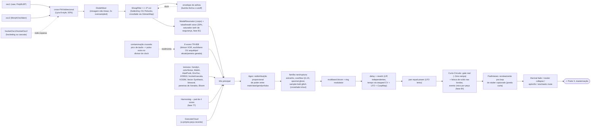
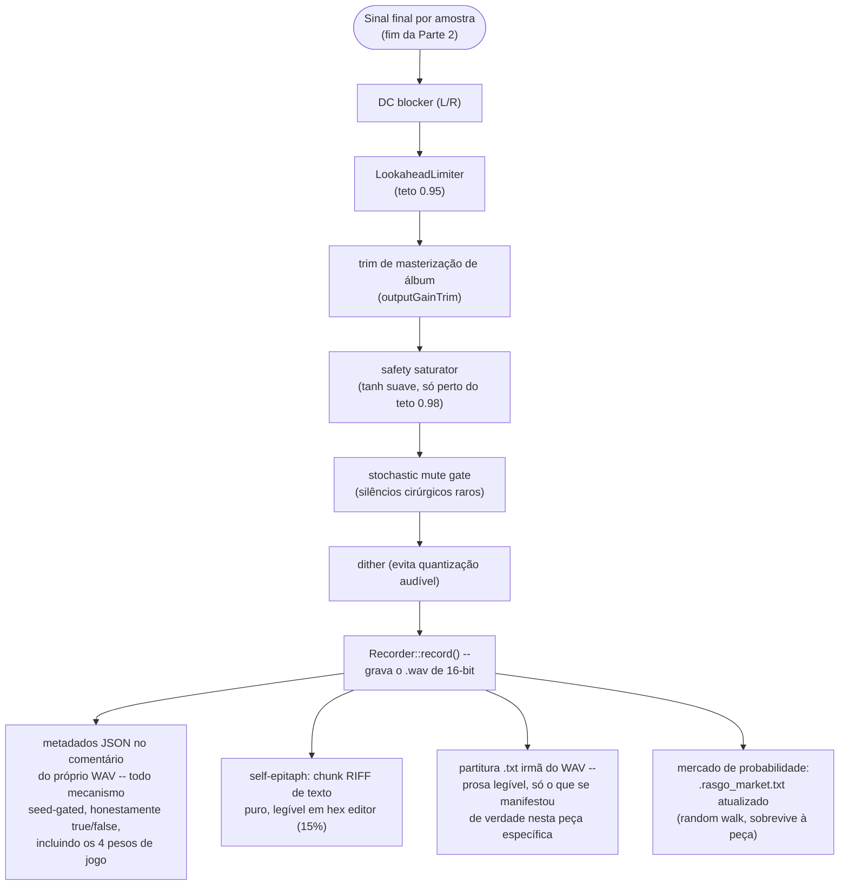
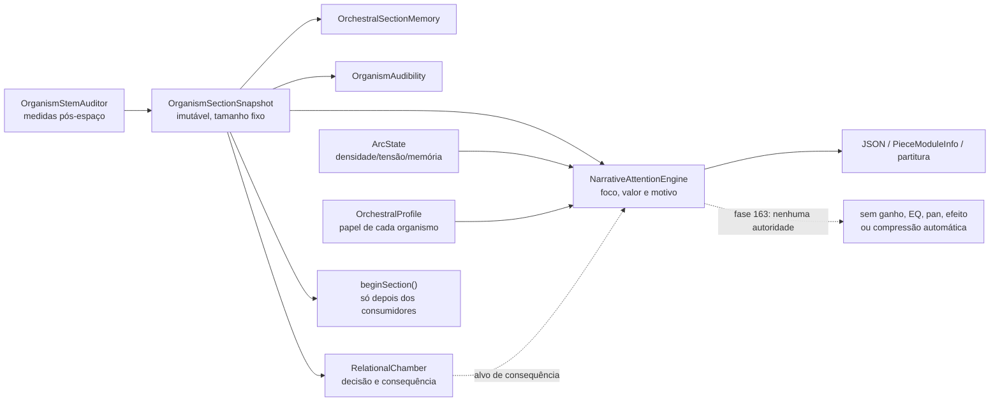

# Rasgo Synth -- fluxograma de arquitetura (base phase84, atualização operacional 2026-08-22)

Substitui o fluxograma Mermaid publicado como artifact na fase 38 (e a versão
ilustrada/blueprint redesenhada depois, ambas fora do repositório -- essa
sessão não tem acesso à ferramenta de publicar artifact, então esta versão
vive como arquivo versionado, o que tem a vantagem de nunca mais ficar
defasada silenciosamente). Cinco partes: escolhas por semente, fluxo de sinal
por amostra, cadeia de masterização, classificação dos mecanismos, e mapa de
entrecruzamento/simbiose entre eles, e a pista de percepção por seção.
Atualizado de phase76 para phase84 --
Harmonàig/polifonia de peneiras/Bloom (77-79), pesos de jogo de Caillois (80,
agora um hub próprio de viés cruzado, ver Parte 5), aksak/peneira rítmica
(82), e Curto-Circuito (84).

Cada mecanismo citado tem sua fase de origem entre parênteses -- consulte
[`Plano_de_Upgrade_Instrumento_Generativo.md`](../../Plano_de_Upgrade_Instrumento_Generativo.md)
pra a história completa de qualquer um deles.

O diagrama da phase84 permanece como base estrutural. As fases 118–124, 163 e 164
adicionaram agência material, ecologia de audibilidade pós-espaço, orquestração
relacional, memória, atenção narrativa e linhagem explícita de seed. A Parte 6
explicita a nova pista de descritores sem confundi-la com o fluxo de áudio por
amostra.

## Parte 1 -- o que a semente decide, uma vez, no início da peça

```mermaid
flowchart TB
    SEED(["Semente (cfg.seed)"]) --> RNG["std::mt19937 rng(seed)"]
    PAISA["Identidade do pai A"] --> LINHAGEM
    PAISB["Identidade do pai B"] --> LINHAGEM
    LINHAGEM["SeedLineage (fase 164): 9 domínios,<br/>blend + mutação + proveniência"] --> SEED
    LINHAGEM -. override explícito .-> IDENTIDADE
    SEED --> IDENTIDADE["CompositionIdentity: streams estáveis<br/>material/pitch/vozes/ritmo/harmonia/<br/>ensemble/espectral"]

    RNG --> CAILLOIS
    RNG --> ESCALA
    RNG --> RITMO
    RNG --> HARMONIA
    RNG --> TEXTURA
    RNG --> ESTRUTURA
    RNG --> RARO
    RNG --> GARANTIA
    IDENTIDADE --> ESCALA
    IDENTIDADE --> RITMO
    IDENTIDADE --> HARMONIA
    IDENTIDADE --> TEXTURA

    subgraph CAILLOIS["Pesos de jogo de Caillois (fase 80)"]
        direction TB
        C1["4-simplex via stick-breaking:\nAlea/Agon/Ilinx/Mimicry"]
        C2["enviesa (nunca força) onze\nmecanismos existentes -- ver Parte 5"]
    end

    subgraph ESCALA["Escala"]
        direction TB
        E1["catálogo de 39 escalas (padrão)"]
        E2["OU escala sieve de Xenakis gerada,\nnão-catalogada (12%, fase 61,\nmercado de probabilidade)"]
        E3["blend secundário do catálogo (40%)"]
        E4["modulação modal (fase 33) OU\nmodulação tonal (fase 32/48) --\nmutuamente exclusivas"]
    end

    subgraph HARMONIA["Harmonia/melodia"]
        direction TB
        H1["peso funcional em tempo forte (50%, fase 29)"]
        H2["progressão de acorde fixa I-IV-V... (50%)"]
        H3["OU Neo-Riemanniano P/L/R,\ntríade real vagando (35% de H2, fase 65)"]
        H4["condução de voz por índice de grau\n(closenessFactor, padrão)"]
        H5["OU condução de voz real por semitom,\nmistura 80/15/5% (20%, fase 62)"]
        H6["entonação livre (caos empurra o pitch\npra fora da escala) -- acoplada\nINVERSAMENTE ao ritmo via Heisenberg\n(25%, fase 71)"]
        H7["Harmonàig -- pad de 4 vozes reais\n(raiz/3a/5a/7a), só com progressão de\nacorde ativa, viesado por Agon\n(fase 77)"]
    end

    subgraph RITMO["Ritmo/percussão"]
        direction TB
        R1["divisor XOR (CGS22) -- bumbo/caixa/\nchimbal/cowbell/clap/tom/prato/maracas"]
        R2["cowbell: XOR padrão OU euclidiano\nreal Bjorklund/Toussaint (25%, fase 57)"]
        R3["OU arquétipo entre 8 opções (5 nomeados\n+ 2 aksak balcânicos reais + 1 peneira\nrítmica de Xenakis gerada), re-sorteado\na cada seção do arco (fases 67/82,\nmercado de probabilidade)"]
        R4["endereço de passo caótico -- ponteiro\nda MELODIA (não da percussão) lido\npor StandardMap dedicado (15%, fase 64,\nmercado de probabilidade)"]
        R5["humanização rítmica (~50%) --\nacoplada INVERSAMENTE à afinação\nvia Heisenberg (fase 71)"]
        R6["contágio do caos: decay de bumbo/caixa/\nchimbal jitterizado por hit"]
        R7["ratchet nos toms, sustain estendido\nno prato (por hit, não por peça)"]
        R8["bateria como instrumento real:\npresença rida à densidade do arco,\n12% sem bateria, falhas reais por hit\nem 35% das peças (fase 66,\nmercado de probabilidade)"]
    end

    subgraph TEXTURA["Texturas de fundo"]
        direction TB
        T1["Gendyn (Xenakis), ruído colorido,\nAtari Punk, AY8910 arpejo, Ochd LFOs"]
        T2["Oscilador Walsh -- base ortogonal +-1,\nHadamard/sequency (30%, fase 59,\nmercado de probabilidade)"]
        T3["hocketing aditivo (40%)"]
        T4["OU cascata polifônica -- Shifty real,\nregistro de deslocamento (35% de T3,\ndiode-mixado, fase 63, mercado de\nprobabilidade)"]
        T5["granular cloud da própria peça"]
        T6["VOSIM -- 6º princípio de síntese,\nrajadas sin² decaindo (20%, fase 72)"]
        T7["Vector Synthesis -- crossfade 2D real\n(Prophet VS-inspirado) entre banco\ndedicado Gendyn/Walsh/AtariPunk/ruído,\nposição por 2 mapas de caos (20%,\nfase 76)"]
        T8["batimento binaural caótico -- L/R\ndivergem em frequência de verdade\n(20%, fase 73)"]
        T9["polifonia de peneiras de Xenakis --\n4 canais independentes (madeira/sopro,\nmetal/vidro, água, plasma reativo),\nviesado por Agon (20%, fase 78)"]
        T10["Bloom -- melodia fractal Trunk/Branch/\nPath, trunk reaplicado sobre si mesmo\n(22%, fase 79)"]
    end

    subgraph ESTRUTURA["Arco/estrutura"]
        direction TB
        S1["template narrativo: dramatic OU\nkishotenketsu (cadeia de Markov)"]
        S2["andamento variável discreto +\nritardando real na coda"]
        S2b["OU accelerando/stringendo rumo ao\nclímax -- ritardando tem a palavra\nfinal na coda (fase 68, mercado de\nprobabilidade)"]
        S3["morte térmica: esmaecimento lento OU\ncorte abrupto no final -- viesado\npor Ilinx"]
        S4["rossler collapse, self-epitaph,\narquivo apócrifo, stochastic mute --\nviesados por Ilinx/Mimicry"]
        S5["Parênteses -- reroteamento real do\náudio final pra loop de stutter\ncapturado, retorno exato, viesado\npor Mimicry (20%, fase 70)"]
    end

    subgraph RARO["Mecanismos raros/ruptura"]
        direction TB
        X1["Agon -- 4 vozes competindo por poder\n(main/atari/gendyn/tuba), viesado\npor Agon (30%)"]
        X2["elemento estranho interno (15%) +\nversão literal, lê CPU real (25%) --\nquebra reprodutibilidade quando dispara,\nviesado por Mimicry"]
        X3["overflow Q1.15, spectral ghost,\nsample-hold glitch -- 15% cada"]
        X4["contaminação cruzada: pico de áudio\nreal empurra o divisor de clock (25%,\nfase 60, mercado de probabilidade)"]
        X5["fracture folder, rungler,\nleibniz rectifier -- viesados por Ilinx"]
        X6["filtro Polivoks -- 3ª cor, auto-\noscilação genuína (damping negativo +\ntanh), mutuamente exclusivo com\nSallenKeyFilter no mesmo slot (25%,\nfase 75)"]
        X7["envelope de asfixia por sidechain --\nbumbo fecha o filtro, recovery\nexponencial (25%, fase 74)"]
        X8["Curto-Circuito -- corte seco real\n(gate + faísca) + re-sorteio forçado\nde 6 mecanismos que ficaram desligados,\nviesado por Ilinx, evento único por\npeça (fase 84)"]
    end

    subgraph GARANTIA["Rede de segurança (fase 40)"]
        direction TB
        G1["se apócrifo + entonação livre +\nmodulação tonal + self-feedback\ntodos saíram 'não' por acaso..."]
        G2["...um deles é forçado --\ntoda peça testa 1 limite real"]
        G1 --> G2
    end
```

`SeedLineage` não controla diretamente os indicadores do painel. A identidade
recombinada atua antes da trajetória; o renderer ainda contém um RNG sequencial
compartilhado para muitas decisões downstream. Portanto, herança fina de cada
módulo depende de futura separação de domínios e não é presumida neste diagrama.

## Parte 2 -- fluxo de sinal, uma amostra de cada vez

## Parte 3 -- cadeia de masterização

## Parte 4 -- classificação dos mecanismos

Não é uma lista exaustiva de todos os mecanismos do motor (isso duplicaria
o `Plano_de_Upgrade_Instrumento_Generativo.md` inteiro) -- é uma
classificação por **tipo estrutural**, a pergunta "que espécie de decisão é
essa, e o que ela compete ou não compete com". Todo mecanismo do motor cai
numa (ou mais de uma) destas cinco categorias:

### A. Escolha estrutural única (roda uma vez, decide entre alternativas que se excluem)

A semente decide uma bifurcação e só um dos lados existe na peça inteira --
nunca os dois ao mesmo tempo, disciplina de "um modo limpo, não camadas"
deste projeto.

| Mecanismo (fase) | Alternativa mutuamente exclusiva |
|---|---|
| Filtro Polivoks (75) | SallenKeyFilter -- mesmo slot de crossfade com MoogFilter |
| Neo-Riemanniano P/L/R (65) | Progressão de acordes fixa I-IV-V... |
| Condução de voz por semitom (62) | Condução de voz por índice de grau (padrão) |
| Escala sieve de Xenakis (61) | Catálogo de 39 escalas (padrão) |
| Arquétipo rítmico de 16 passos (67/82) | Divisor XOR padrão pra bumbo/caixa/chimbal |
| Cowbell euclidiano (57) | Cowbell via divisor XOR padrão |
| Modulação modal (33) | Modulação tonal (32/48) |
| Cascata polifônica/Shifty (63) | Hocketing aditivo simples (37) |
| Ritardando de coda (48) | Accelerando/stringendo (68) -- ritardando vence se a coda chega de verdade |
| Escala por peça (48) | Não mais forçada por tema de álbum (fase 83) -- toda peça, álbum ou não, sorteia a própria |

### B. Camada aditiva independente (liga/desliga, não compete por um "slot")

Mistura continuamente quando habilitada, junto de qualquer outra coisa que
esteja acontecendo -- não há conflito, só presença ou ausência.

Exemplos: Oscilador Walsh (59), VOSIM (72), Vector Synthesis (76), batimento
binaural caótico (73), tuba/breath voice (43), granular cloud, ring
modulator, multiband bloom, ratchet de toms/sustain de prato (56), Harmonàig
(77, condicionado a progressão de acorde ativa), polifonia de peneiras de
Xenakis (78), Bloom (79).

### C. Acoplamento cruzado direto (a saída de um mecanismo modula o parâmetro/estado de outro)

O ponto mais "vivo" da arquitetura -- onde um mecanismo não é só um efeito
isolado, mas genuinamente alimenta outro. Ver mapa completo na Parte 5.

Exemplos: contaminação cruzada (60, pico de áudio -> pulso extra no divisor
de clock), asfixia por sidechain (74, bumbo -> corte do filtro), Heisenberg
(71, um balanço -> ritmo E afinação em direções opostas), Vector Synthesis
(76, dois mapas de caos -> posição X/Y do crossfade), Agon (49, staleness da
melodia -> redistribuição de poder entre 4 vozes), pesos de jogo de Caillois
(80, quatro pesos -> viés de probabilidade de onze mecanismos), trajetória
de álbum (83, dois pontos do simplex -> ponto interpolado por faixa).

### D. Estado persistente entre renders (sobrevive ao fim da peça)

Categoria rara -- a esmagadora maioria do motor é 100% determinística a
partir da semente, sem memória entre execuções. Só duas exceções, ambas
documentadas com honestidade explícita no JSON:

- **Elemento estranho, versão literal (50-51)**: lê temperatura/carga real
  da CPU no momento do render -- a mesma semente pode produzir peças
  levemente diferentes.
- **Mercado de probabilidades (69)**: oito mecanismos recentes (ver tabela
  na Parte 5) trocam probabilidade fixa por um "preço" com random walk e
  reversão à média, persistido em `.rasgo_market.txt`, bounded 0.03-0.97.

Há ainda uma ruptura deliberadamente escolhida pelo usuário: o **Modo
Selvagem**, ligado por padrão no Studio, re-semeia o gerador compartilhado
com entropia real a cada fronteira de compasso. A seed continua sendo o
ponto de partida e é registrada, mas o percurso pode divergir entre renders;
`wildMode` e `wildReseedCount` tornam essa condição auditável. Desligar o modo
selvagem restaura a reprodução determinística, respeitando também o mesmo
andamento, configuração, versão do motor e estado externo documentado acima.

### E. Rede de garantia / ativação forçada (dispara em reação a outros mecanismos)

Dois mecanismos usam o mesmo idioma -- virar uma flag e configurar o objeto
na hora -- mas por gatilhos opostos:

- **Garantia de limite (fase 40)**: observa se apócrifo + entonação livre +
  modulação tonal + self-feedback saíram todos "não" por acaso, e força um
  deles ANTES do loop principal começar -- toda peça testa de verdade pelo
  menos um mecanismo de risco.
- **Curto-Circuito (fase 84)**: no MEIO da peça, um corte seco real dispara
  e, no mesmo instante, dá uma segunda chance elevada (40% cada) a seis
  mecanismos que já tinham sorteado "não" no início (apócrifo, entonação
  livre, modulação tonal, self-feedback, rungler, elemento estranho) --
  mesmo idioma de ativação forçada, mas reagindo a uma ruptura, não a uma
  ausência total de risco.

## Parte 5 -- mapa de entrecruzamento e simbiose

Grafo dos acoplamentos reais (categoria C acima) -- que mecanismo lê ou
altera o estado de qual outro, distinto da Parte 2 (que é só o caminho do
sinal de áudio amostra a amostra).

```mermaid
flowchart TB
    subgraph MAPS["Mapas de caos compartilhados (9 no total)"]
        direction LR
        CHAOS["Henon/Lato/Standard/Gbman/Cusp/\nQuad/Rossler/StandardMap dedicado"]
    end

    CHAOS --> FILTROCROSS["crossfade Moog<->2ª cor (GbmanMap)"]
    CHAOS --> VECTORPOS["posição X/Y do Vector Synthesis\n(2 mapas independentes, fase 76)"]
    CHAOS --> STEPADDR["endereço de passo caótico da melodia\n(StandardMap dedicado, fase 64)"]
    CHAOS --> GRANJIT["jitter de pitch do granular (QuadMap)"]
    CHAOS --> ROSSCOLL["rossler collapse -- espiral que\nerupciona em chute de filtro (fase 46)"]
    CHAOS --> BINAURAL["desvio de frequência L/R\n(batimento binaural, fase 73)"]
    CHAOS --> SIEVECLOCK["clocks independentes das 4 peneiras\nde Xenakis (Lorenz, fase 78)"]

    subgraph GAMEWEIGHTS["Pesos de jogo de Caillois (fase 80)\n-- hub de viés cruzado"]
        direction TB
        GW["Alea / Agon / Ilinx / Mimicry\n(4-simplex, stick-breaking)"]
    end

    GW -.enviesa.-> GWAGON["Agon, Harmonàig,\npolifonia de peneiras"]
    GW -.enviesa.-> GWILINX["Rungler, Rossler, thermal fade,\nself-feedback, stochastic mute,\nLeibniz, Curto-Circuito (84)"]
    GW -.enviesa.-> GWMIMICRY["apócrifo, self-epitaph,\nsinal estrangeiro, parênteses,\nelemento estranho"]
    GW -.trajetória por faixa.-> GWALBUM["AlbumRenderer: ponto\ninterpolado no simplex\npor faixa (fase 83)"]

    KICK["hit real de bumbo (percussão)"] -.dispara.-> ASPHYXIA["asfixia: fecha o filtro,\nrecovery exponencial (fase 74)"]
    ASPHYXIA -.multiplica.-> CUTOFF["cutoff do filtro principal"]

    PEAKFOLLOW["seguidor de pico rápido\n(áudio real, não a média lenta\ndo self-feedback)"] -.excede limiar.-> CONTAGION2["contaminação cruzada\n(fase 60)"]
    CONTAGION2 -.pulso extra.-> CLOCKDIV["divisor de clock XOR\ncompartilhado (percussão)"]

    HEISBAL["balanço Heisenberg\n(único valor seed-derivado, fase 71)"]
    HEISBAL -.sobe.-> HUMANIZE["humanizeMaxSamples\n(precisão RÍTMICA solta)"]
    HEISBAL -.sobe, efeito inverso.-> INTONATION["freeIntonationDepth\n(precisão de AFINAÇÃO trava)"]

    MELSTALE["melodia detectada como estagnada"] -.arma.-> AGONTRIG["Agon: disputa de poder\n(fase 49)"]
    AGONTRIG -.redistribui proporcional.-> VOICES["main/atari/gendyn/tuba\n(cada um cede à própria distância\nda vencedora)"]

    MARKETSTATE[(".rasgo_market.txt\n(random walk persistido)")]
    MARKETSTATE -.preço usado nesta peça.-> M1["generatedScale (12%)"]
    MARKETSTATE -.-> M2["chaosStepAddress (15%)"]
    MARKETSTATE -.-> M3["hocketCascade (35%)"]
    MARKETSTATE -.-> M4["walshOscillator (30%)"]
    MARKETSTATE -.-> M5["crossDomainContagion (25%)"]
    MARKETSTATE -.-> M6["drumsEnabled (88%)"]
    MARKETSTATE -.-> M7["drumArchetype (35%)"]
    MARKETSTATE -.-> M8["accelerando (40%)"]
    M1 -.settle apos a peça.-> MARKETSTATE
    M8 -.settle apos a peca.-> MARKETSTATE

    GUARANTEE1["apócrifo + entonação livre +\nmodulação tonal + self-feedback"] -.todos 'não'?.-> GUARANTEE2["força 1 deles\n(fase 40)"]

    CURTOFIRE["Curto-Circuito dispara\n(fase 84)"] -.corte seco real.-> CURTOGATE["gate + faísca de ruído\n(~3ms rampa)"]
    CURTOFIRE -.re-sorteio 40% cada.-> CURTOCRASH["apócrifo, entonação livre,\nmodulação tonal, self-feedback,\nrungler, elemento estranho"]
```

## Parte 6 -- percepção narrativa por seção (sem atuação de mix na fase 163)

Esta pista roda nas fronteiras composicionais. Ela não transporta áudio e não
faz trabalho variável no callback: todos os consumidores recebem a mesma
fotografia fixa da seção encerrada antes que os acumuladores sejam reiniciados.

O próximo incremento poderá inserir um `NarrativeMixDirective` entre atenção
e controles existentes, mas essa seta ainda não existe. Ela só será adicionada
ao fluxograma quando houver limite, suavização, contrafactual e A/B perceptivo.

## Nota sobre honestidade

Todo mecanismo seed-gated acima aparece no JSON de metadados e na partitura
`.txt` como `true`/`false` reais -- nunca "presente mas nunca testado". A
disciplina deste projeto (ver `feedback_rasgo_quality_bar` e o histórico de
bugs pegos por *verificação empírica*, não só compilação limpa) é: todo
mecanismo novo é auditado numa amostra de peças renderizadas antes de ser
considerado pronto, contando quantas vezes o campo aparece como `true` e
comparando com a probabilidade esperada -- incluindo, na fase 76, um bug de
*processo* pego dessa forma (binário desatualizado sem o código novo,
denunciado por uma taxa de disparo impossível estatisticamente antes de
qualquer ouvido humano precisar notar), e na fase 84, uma auditoria real em
22 peças confirmando o Curto-Circuito disparando e listando por nome quais
mecanismos entraram de penetra.

O mercado de probabilidades (fase 69, Parte 5 acima) é a única categoria
onde a probabilidade *em si* não é fixa -- mas o valor realmente usado em
cada peça continua exposto no JSON (`marketPrices`), então a honestidade da
auditoria não é comprometida por isso.
